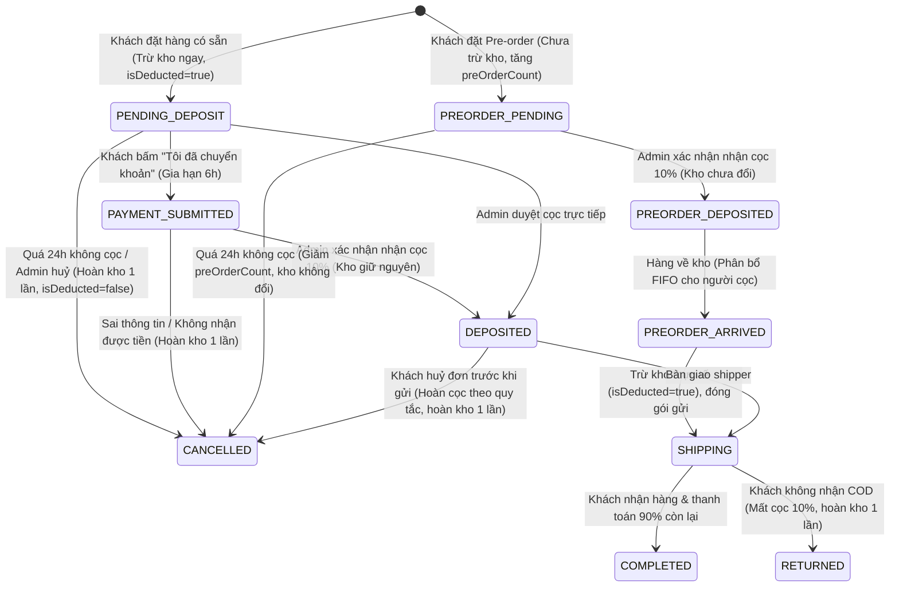

# KẾ HOẠCH TRIỂN KHAI HỆ THỐNG GHOBBY (BẢN V2.2 - MASTER PLAN)
*Website bán mô hình Gundam/Figure & Quản lý xuất nhập kho chuẩn SEO*
*Nền tảng: Next.js (App Router, SSR/SSG/ISR) + Node.js + Prisma ORM + Supabase PostgreSQL & Storage*

---

## 1. ĐIỀU KIỆN TIÊN QUYẾT & KIỂM TRA MÔI TRƯỜNG
Trước khi vận hành dự án, máy tính cần đáp ứng các điều kiện sau:
- **Node.js**: Phiên bản $\ge$ 18.18.0 (Máy tính của bạn đã có sẵn `D:\node.exe` phiên bản **v24.21.0** $\rightarrow$ Đạt chuẩn).
- **Git**: Phiên bản $\ge$ 2.x (Máy tính đã cài đặt `git version 2.56.0` $\rightarrow$ Đạt chuẩn).
- **Trình quản lý gói**: npm phiên bản $\ge$ 10.x (Máy tính có `npm 11.19.0` $\rightarrow$ Đạt chuẩn).
- **Cách tự kiểm tra**: Mở PowerShell trên Windows và chạy:
  ```powershell
  $env:PATH = "D:\;D:\node_modules\npm\bin;$env:PATH"
  node -v
  git --version
  ```

---

## 2. KIẾN TRÚC & CÔNG NGHỆ CỐT LÕI

### 2.1. Framework & Nền tảng thực thi
- **Ngôn ngữ**: TypeScript / JavaScript (Type-safety từ Database đến Giao diện).
- **Framework**: **Next.js 15+ (App Router)** chạy trên môi trường **Node.js**.
- **Giao diện**: **Tailwind CSS** được biên dịch thành file CSS tĩnh khi build dự án (Build-time PostCSS/Tailwind), **tuyệt đối không dùng CDN**, đảm bảo tải cực nhanh và chạy offline ổn định.
- **Xử lý hình ảnh**: Thư viện **Sharp** (chạy trên Node.js) để kiểm tra magic bytes nhị phân, loại bỏ EXIF metadata, nén và chuyển đổi sang `.webp` chuẩn.
- **ORM & Database**: **Prisma ORM** kết nối **PostgreSQL trên Supabase Cloud**.
- **Lưu trữ ảnh**: **Supabase Storage** (Bucket public `ghobby-products`, upload qua Node Server bảo vệ bằng `SUPABASE_SERVICE_ROLE_KEY`).

### 2.2. Chế độ Render (Rendering Strategy) từng trang & Cập nhật giá/tồn kho
Để website đạt tốc độ tải tức thì (Core Web Vitals cao) nhưng vẫn bảo đảm giá bán và số lượng tồn kho luôn chính xác 100%:
1. **Trang chủ (`/`)**: 
   - *Chế độ*: **ISR (Incremental Static Regeneration)** với thời gian hoàn nguyên `revalidate = 60` giây kết hợp Server Action revalidate theo tag (`revalidateTag('products')`).
   - Khi có thay đổi giá hoặc tồn kho trong Admin, hệ thống gọi `revalidatePath('/')` để trang chủ cập nhật ngay lập tức mà không cần chờ hết 60s.
2. **Trang danh mục (`/danh-muc/[slug]`)**: 
   - *Chế độ*: **Dynamic SSR (Server-Side Rendering)**. Render trực tiếp từ Database theo từng yêu cầu lọc và phân trang, đảm bảo bot tìm kiếm và khách hàng luôn thấy sản phẩm mới nhất.
3. **Trang chi tiết sản phẩm (`/san-pham/[slug]`)**: 
   - *Chế độ*: **Dynamic SSR**. Truy vấn tồn kho và giá bán trực tiếp từ Database theo thời gian thực (real-time) tại thời điểm khách mở trang. Khách không bao giờ nhìn thấy tồn kho ảo bị cache cũ.
4. **Trang xem đơn hàng của khách (`/don-hang/[code]`)**: 
   - *Chế độ*: **Dynamic SSR (Private, Noindex)**. Truy vấn trạng thái đơn và cọc trực tiếp.
5. **Trang quản trị (`/admin/*`)**: 
   - *Chế độ*: **Client-Side Rendering (CSR)** bọc trong Server Component Layout được gắn `noindex, nofollow`.

---

## 3. CẤU TRÚC THƯ MỤC VÀ FILE DỰ ÁN

```
d:/GHobby/
├── .env.example              # Mẫu biến môi trường (không chứa key thật)
├── .env                      # File môi trường thực tế (chặn bởi .gitignore)
├── .gitignore                # Chặn node_modules, .env, .next, database
├── package.json              # Khai báo thư viện & kịch bản chạy
├── tsconfig.json             # Cấu hình TypeScript path alias @/*
├── next.config.ts            # Cấu hình Next.js, remotePatterns ảnh
├── tailwind.config.ts        # Cấu hình màu sắc thương hiệu Gundam
├── postcss.config.js         # Biên dịch CSS tĩnh
├── run.bat                   # File 1-click nhấp đúp khởi động server trên Windows
├── prisma/
│   ├── schema.prisma         # Schema dữ liệu Prisma đầy đủ
│   ├── seed.ts               # Script nạp dữ liệu mẫu khi có cờ USE_SAMPLE_DATA
│   └── migrations/           # Lịch sử migration SQL (chứa RLS và CHECK constraint)
├── test/
│   ├── inventory.test.js     # Bộ test độc lập logic kho trên TEST_DATABASE_URL
│   └── run-tests.bat         # Kịch bản chạy test an toàn
├── src/
│   ├── app/
│   │   ├── layout.tsx        # Root layout, Organization Schema, Header, Footer
│   │   ├── page.tsx          # Trang chủ SSR/ISR, 1 thẻ H1, danh mục, kit nổi bật
│   │   ├── globals.css       # Tailwind CSS tĩnh
│   │   ├── not-found.tsx     # Trang 404 chuẩn HTTP 404
│   │   ├── robots.ts         # Tự động sinh robots.txt chặn /admin và /don-hang/
│   │   ├── sitemap.ts        # Tự động sinh sitemap.xml từ DB
│   │   ├── danh-muc/
│   │   │   └── [slug]/
│   │   │       └── page.tsx  # Trang danh mục SSR, phân trang <a> thật
│   │   ├── san-pham/
│   │   │   └── [slug]/
│   │   │       └── page.tsx  # Trang chi tiết SSR, Product Schema, Breadcrumb
│   │   ├── gio-hang/
│   │   │   └── page.tsx      # Giỏ hàng tách đơn có sẵn vs Pre-order
│   │   ├── don-hang/
│   │   │   └── [code]/
│   │   │       └── page.tsx  # Xem đơn hàng bảo mật (noindex, viewToken, VietQR)
│   │   ├── admin/
│   │   │   ├── layout.tsx    # Admin layout (noindex, nofollow)
│   │   │   ├── login/        # Trang đăng nhập admin chống brute-force
│   │   │   ├── doi-mat-khau/ # Đổi mật khẩu bắt buộc ở lần đầu
│   │   │   ├── page.tsx      # Dashboard tổng quan kho & đơn
│   │   │   ├── san-pham/     # Quản lý danh sách, thêm, sửa, ẩn kit
│   │   │   ├── kho/          # Phiếu nhập, xuất, lịch sử 7 loại biến động
│   │   │   ├── don-hang/     # Quản lý đơn, duyệt cọc, khôi phục đơn
│   │   │   └── cai-dat/      # Cấu hình khu vực nội thành, phí ship, ngân hàng
│   │   └── api/              # Route Handlers kiểm tra CSRF Origin
│   │       ├── auth/         # Login, logout thu hồi session, đổi mật khẩu
│   │       ├── products/     # CRUD sản phẩm
│   │       ├── inventory/    # Nhập, xuất, kiểm kê kho an toàn
│   │       ├── orders/       # Tạo đơn, tra cứu, huỷ đơn
│   │       ├── admin/
│   │       │   ├── upload/   # Upload ảnh Sharp WebP lên Supabase
│   │       │   └── orders/   # Duyệt cọc, chuyển trạng thái pre-order
│   │       └── cron/
│   │           └── auto-cancel/ # Route huỷ đơn 24h có bảo vệ CRON_SECRET
│   ├── components/
│   │   ├── Header.tsx        # Menu, danh mục, giỏ hàng (không hiện STK ở đây)
│   │   ├── Footer.tsx        # Chân trang thông tin shop từ cấu hình
│   │   ├── ProductCard.tsx   # Thẻ sản phẩm, next/image kích thước cố định
│   │   ├── Breadcrumb.tsx    # Breadcrumb điều hướng phân cấp
│   │   └── VietQRDisplay.tsx # Hiển thị mã QR VietQR + nút copy STK dự phòng
│   ├── data/
│   │   └── sample-products.ts# Dữ liệu mẫu (chỉ dùng khi bật cờ USE_SAMPLE_DATA)
│   ├── lib/
│   │   ├── prisma.ts         # Singleton Prisma Client
│   │   ├── supabase.ts       # Supabase Client khởi tạo qua Service Role Key
│   │   ├── seo.ts            # Schema JSON-LD (Product, Breadcrumb, Org)
│   │   ├── vietqr.ts         # Sinh link VietQR chuẩn hóa encodeURIComponent
│   │   ├── settings.ts       # Lấy cấu hình shop từ StoreSetting/env
│   │   └── utils.ts          # Định dạng tiền VND nguyên số, slug không dấu
│   └── types/
│       └── index.ts          # Định nghĩa kiểu TypeScript
└── plan.md                   # Tài liệu kế hoạch v2.2 này
```

---

## 4. SƠ ĐỒ DỮ LIỆU PRISMA TOÀN DIỆN (SCHEMA V2.2)

### 4.1. File `prisma/schema.prisma`

```prisma
datasource db {
  provider  = "postgresql"
  url       = env("DATABASE_URL")
  directUrl = env("DIRECT_URL")
}

generator client {
  provider = "prisma-client-js"
}

// ----------------------------------------------------
// ENUMS HỆ THỐNG
// ----------------------------------------------------

enum Role {
  ADMIN
  STAFF
}

enum ProductType {
  IN_STOCK   // Hàng có sẵn trong kho
  PRE_ORDER  // Hàng đặt trước sắp phát hành
}

enum OrderStatus {
  // Chu trình hàng có sẵn:
  PENDING_DEPOSIT     // Vừa đặt, chờ quét VietQR cọc 10% trong 24h (đã trừ kho giữ suất)
  PAYMENT_SUBMITTED   // Khách bấm "Tôi đã chuyển khoản", chờ admin duyệt (gia hạn thêm 6h)
  DEPOSITED           // Admin đã xác nhận nhận đủ cọc 10%
  SHIPPING            // Đang giao hàng
  COMPLETED           // Giao thành công, khách đã thanh toán nốt 90%
  CANCELLED           // Huỷ đơn (quá 24h hoặc khách/admin huỷ) -> Hoàn kho 1 lần
  RETURNED            // Hàng bị trả về hoặc khách từ chối nhận COD -> Mất cọc 10%

  // Chu trình hàng Pre-order:
  PREORDER_PENDING    // Khách đặt trước, chờ cọc 10% trong 24h (chưa trừ kho)
  PREORDER_DEPOSITED  // Đã nhận cọc 10%, ghi nhận suất đặt từ hãng
  PREORDER_ARRIVED    // Hàng thực tế đã cập bến kho shop, bắt đầu phân bổ cho khách cọc
}

enum InventoryChangeType {
  IMPORT                 // Nhập hàng mới từ nhà phân phối/hãng
  EXPORT_MANUAL          // Xuất bán lẻ trực tiếp tại cửa hàng
  ORDER_DEDUCT           // Trừ kho tự động khi khách đặt đơn hàng có sẵn
  ORDER_CANCEL_RESTOCK   // Hoàn kho khi đơn bị huỷ (sau 24h hoặc admin huỷ)
  ADJUST                 // Cân chỉnh tồn kho sau kiểm kê thực tế
  DAMAGED                // Xuất loại bỏ do hàng lỗi runner, móp hộp nặng
  WARRANTY               // Xuất linh kiện / part thay thế cho khách
}

// ----------------------------------------------------
// MODELS HỆ THỐNG
// ----------------------------------------------------

// 1. Quản trị viên
model User {
  id                 String               @id @default(uuid())
  username           String               @unique
  passwordHash       String
  fullName           String
  role               Role                 @default(ADMIN)
  mustChangePassword Boolean              @default(true) // Buộc đổi mật khẩu ở lần đăng nhập đầu
  sessions           Session[]
  inventoryLogs      InventoryLog[]
  statusHistories    OrderStatusHistory[]
  confirmedOrders    Order[]              @relation("ConfirmedDepositUser")
  createdAt          DateTime             @default(now())
  updatedAt          DateTime             @updatedAt
}

// 2. Phiên làm việc Admin (Lưu DB, thu hồi tức thì khi đăng xuất)
model Session {
  id           String    @id @default(uuid())
  userId       String
  user         User      @relation(fields: [userId], references: [id], onDelete: Cascade)
  tokenHash    String    @unique // Mã băm SHA-256 của Session Token
  ipAddress    String?
  userAgent    String?
  expiresAt    DateTime
  revokedAt    DateTime? // Khác null nghĩa là đã bị đăng xuất/thu hồi
  createdAt    DateTime  @default(now())

  @@index([tokenHash])
  @@index([expiresAt])
}

// 3. Lịch sử đăng nhập chống Brute-force trong DB
model LoginAttempt {
  id          String   @id @default(uuid())
  ipAddress   String
  username    String
  isSuccess   Boolean  @default(false)
  createdAt   DateTime @default(now())

  @@index([ipAddress, createdAt])
  @@index([username, createdAt])
}

// 4. Danh mục sản phẩm Gunpla
model Category {
  id          String    @id @default(uuid())
  name        String
  slug        String    @unique
  description String?
  products    Product[]
  createdAt   DateTime  @default(now())

  @@index([slug])
}

// 5. Sản phẩm Gunpla / Figure
model Product {
  id                  String         @id @default(uuid())
  sku                 String         @unique
  name                String
  slug                String         @unique
  categoryId          String
  category            Category       @relation(fields: [categoryId], references: [id])
  brand               String         // Bandai Spirits, Kotobukiya...
  scale               String         // 1/144, 1/100, 1/60, Non-scale...
  series              String         // Universal Century, Seed, 00, WfM...
  costPrice           Int            // Giá vốn số nguyên VND
  sellingPrice        Int            // Giá bán số nguyên VND
  stockQuantity       Int            @default(0) // Tồn kho thực tế (có ràng buộc CHECK >= 0)
  minStockAlert       Int            @default(2) // Ngưỡng cảnh báo sắp hết
  productType         ProductType    @default(IN_STOCK)
  expectedReleaseDate DateTime?      // Kiểu ngày thực tế cho hàng Pre-order
  preOrderLimit       Int            @default(0) // Giới hạn tối đa số suất cho phép đặt trước
  preOrderCount       Int            @default(0) // Số suất khách đã cọc thành công
  imageUrl            String         // URL ảnh công khai trên Supabase Storage
  description         String
  isActive            Boolean        @default(true) // Ẩn / Hiện (Soft delete)
  orderItems          OrderItem[]
  inventoryLogs       InventoryLog[]
  createdAt           DateTime       @default(now())
  updatedAt           DateTime       @updatedAt

  @@index([slug])
  @@index([categoryId])
  @@index([isActive])
}

// 6. Lịch sử biến động kho (Tuyệt đối không xoá)
model InventoryLog {
  id           String              @id @default(uuid())
  productId    String
  product      Product             @relation(fields: [productId], references: [id])
  orderId      String?             // Liên kết tuỳ chọn tới đơn hàng phát sinh biến động
  order        Order?              @relation(fields: [orderId], references: [id])
  changeType   InventoryChangeType
  quantity     Int                 // Dương (+) tăng, Âm (-) giảm
  balanceAfter Int                 // Tồn kho thực tế sau biến động
  costPrice    Int?                // Giá vốn tại thời điểm biến động
  note         String?             // Lý do hoặc mã đơn hàng
  createdById  String?             // Khác null nếu do User thao tác, null nếu do SYSTEM
  createdBy    User?               @relation(fields: [createdById], references: [id])
  creatorName  String              // Tên hiển thị ("Admin Nguyen" hoặc "SYSTEM")
  createdAt    DateTime            @default(now())

  @@index([productId])
  @@index([orderId])
  @@index([createdAt])
}

// 7. Đơn hàng (Tuyệt đối không xoá cứng)
model Order {
  id                   String               @id @default(uuid())
  orderCode            String               @unique // Mã đơn khó đoán: GHB-XXXXXX
  viewToken            String               @unique // Token bảo mật 32 ký tự để khách xem đơn
  customerName         String
  customerPhone        String
  customerAddress      String
  provinceCity         String               // Tỉnh / Thành phố
  shippingArea         String               // Khu vực (Nội thành / Ngoại thành) cấu hình được
  isInnerCity          Boolean              @default(false)
  shippingFee          Int                  // 0 (Zalo thỏa thuận) hoặc phí cố định (20.000đ)
  totalProductAmount   Int                  // Tổng tiền hàng nguyên số VND
  depositRequired      Int                  // Tiền cọc 10% tính trên tiền hàng (chưa gồm ship)
  depositPaid          Boolean              @default(false)
  status               OrderStatus          @default(PENDING_DEPOSIT)
  isPreOrderOrder      Boolean              @default(false) // Đơn này thuần Pre-order hay có sẵn
  customerIp           String?              // IP khách lấy từ proxy tin cậy
  confirmedDepositById String?
  confirmedDepositBy   User?                @relation("ConfirmedDepositUser", fields: [confirmedDepositById], references: [id])
  confirmedDepositAt   DateTime?
  note                 String?
  items                OrderItem[]
  statusHistories      OrderStatusHistory[]
  inventoryLogs        InventoryLog[]
  createdAt            DateTime             @default(now())
  updatedAt            DateTime             @updatedAt

  @@index([orderCode])
  @@index([viewToken])
  @@index([status, createdAt])              // Tối ưu truy vấn quét đơn quá 24h
  @@index([customerPhone, status, createdAt])// Tối ưu kiểm tra đơn chờ cọc của khách
}

// 8. Dòng đơn hàng (Quan hệ Restrict với Order - Không cho xoá đơn nếu có item)
model OrderItem {
  id               String   @id @default(uuid())
  orderId          String
  order            Order    @relation(fields: [orderId], references: [id], onDelete: Restrict)
  productId        String
  product          Product  @relation(fields: [productId], references: [id])
  productName      String   // Tên sản phẩm tại thời điểm mua
  priceAtOrder     Int      // Giá bán tại thời điểm đặt hàng
  costPriceAtOrder Int      // Giá vốn tại thời điểm đặt hàng (tính lãi chuẩn)
  quantity         Int      // Số lượng đặt (> 0)
  isDeducted       Boolean  @default(false) // Cờ kiểm tra: Đã trừ kho thực tế chưa
  isPreOrderItem   Boolean  @default(false)
}

// 9. Lịch sử thay đổi trạng thái đơn hàng (Audit Trail)
model OrderStatusHistory {
  id         String      @id @default(uuid())
  orderId    String
  order      Order       @relation(fields: [orderId], references: [id], onDelete: Cascade)
  fromStatus OrderStatus
  toStatus   OrderStatus
  changedById String?
  changedBy  User?       @relation(fields: [changedById], references: [id])
  actorName  String      // Tên hiển thị người đổi ("Admin A" hoặc "SYSTEM_24H_CRON")
  note       String?
  createdAt  DateTime    @default(now())

  @@index([orderId])
  @@index([createdAt])
}

// 10. Cấu hình cửa hàng linh hoạt trong DB
model StoreSetting {
  id          String   @id @default(uuid())
  key         String   @unique // "inner_city_config", "shipping_config", "bank_config"
  value       String   // Chuỗi JSON cấu hình
  description String?
  updatedAt   DateTime @updatedAt
}
```

### 4.2. Ràng buộc toàn vẹn Database (CHECK Constraints) & Migration SQL
Trong file migration ban đầu (`prisma/migrations/0_init/migration.sql`), bên cạnh các bảng, ta bổ sung các ràng buộc cấp cơ sở dữ liệu:
```sql
-- 1. Ràng buộc tồn kho không được âm
ALTER TABLE "Product" ADD CONSTRAINT "check_stock_non_negative" CHECK ("stockQuantity" >= 0);
ALTER TABLE "Product" ADD CONSTRAINT "check_prices_non_negative" CHECK ("costPrice" >= 0 AND "sellingPrice" >= 0);

-- 2. Ràng buộc số lượng đặt hàng và biến động kho phải hợp lệ
ALTER TABLE "OrderItem" ADD CONSTRAINT "check_order_item_quantity_positive" CHECK ("quantity" > 0);
ALTER TABLE "InventoryLog" ADD CONSTRAINT "check_balance_after_non_negative" CHECK ("balanceAfter" >= 0);

-- 3. Kích hoạt Row Level Security (RLS) cho toàn bộ bảng
ALTER TABLE "User" ENABLE ROW LEVEL SECURITY;
ALTER TABLE "Session" ENABLE ROW LEVEL SECURITY;
ALTER TABLE "LoginAttempt" ENABLE ROW LEVEL SECURITY;
ALTER TABLE "Category" ENABLE ROW LEVEL SECURITY;
ALTER TABLE "Product" ENABLE ROW LEVEL SECURITY;
ALTER TABLE "InventoryLog" ENABLE ROW LEVEL SECURITY;
ALTER TABLE "Order" ENABLE ROW LEVEL SECURITY;
ALTER TABLE "OrderItem" ENABLE ROW LEVEL SECURITY;
ALTER TABLE "OrderStatusHistory" ENABLE ROW LEVEL SECURITY;
ALTER TABLE "StoreSetting" ENABLE ROW LEVEL SECURITY;

-- 4. Cơ chế đảm bảo mọi bảng mới trong tương lai cũng tự động bật RLS
CREATE OR REPLACE FUNCTION public.pgrst_enable_rls_on_new_tables()
RETURNS event_trigger AS $$
DECLARE
  obj record;
BEGIN
  FOR obj IN SELECT * FROM pg_event_trigger_ddl_commands() WHERE command_tag = 'CREATE TABLE' LOOP
    EXECUTE format('ALTER TABLE %s ENABLE ROW LEVEL SECURITY;', obj.object_identity);
  END LOOP;
END;
$$ LANGUAGE plpgsql;

DROP EVENT TRIGGER IF EXISTS trg_enable_rls_on_new_tables;
CREATE EVENT TRIGGER trg_enable_rls_on_new_tables ON ddl_command_end
WHEN TAG IN ('CREATE TABLE')
EXECUTE FUNCTION public.pgrst_enable_rls_on_new_tables();
```

---

## 5. MA TRẬN VÒNG ĐỜI TRẠNG THÁI ĐƠN HÀNG & QUY TẮC KHO

### 5.1. Bảng ma trận chuyển trạng thái & tác động kho



### 5.2. Cơ chế phân bổ Pre-order khi hàng về (FIFO & Giữ chỗ chống cướp suất)
1. **Giữ chỗ chống cướp suất**:
   - Khi sản phẩm Pre-order cập bến, Admin tạo phiếu **`IMPORT`** số lượng $N$ hộp.
   - Hệ thống **tạm khoá (hold)** số lượng tồn kho này, không mở bán công khai trên web cho khách vãng lai.
2. **Phân bổ theo thứ tự cọc (FIFO - First In First Out)**:
   - Nếu số lượng hàng về $N \ge$ tổng số suất đã cọc: Toàn bộ đơn `PREORDER_DEPOSITED` được chuyển sang `PREORDER_ARRIVED`.
   - Nếu hãng cắt giảm số lượng ($N <$ tổng số suất đã cọc):
     - Hệ thống tự động xếp hạng ưu tiên theo thời gian xác nhận cọc thành công (`confirmedDepositAt` ASC).
     - $N$ khách hàng cọc sớm nhất được phân bổ hàng $\rightarrow$ chuyển trạng thái `PREORDER_ARRIVED`.
     - Các khách hàng cọc sau chưa có hàng: Shop thông báo dời đợt sau hoặc **hoàn cọc 100% ngay lập tức**.
3. **Thời điểm trừ kho và xử lý lỗi**:
   - Việc chuyển từ `PREORDER_ARRIVED` sang `SHIPPING` sẽ thực thi lệnh trừ tồn kho trong Prisma Transaction:
     ```typescript
     await prisma.$transaction(async (tx) => {
       // Trừ tồn kho có điều kiện
       const updatedProduct = await tx.product.update({
         where: { id: item.productId, stockQuantity: { gte: item.quantity } },
         data: { stockQuantity: { decrement: item.quantity } }
       });
       // Cập nhật dòng đơn
       await tx.orderItem.update({
         where: { id: item.id },
         data: { isDeducted: true }
       });
       // Ghi lịch sử kho
       await tx.inventoryLog.create({
         data: {
           productId: item.productId,
           orderId: order.id,
           changeType: "ORDER_DEDUCT",
           quantity: -item.quantity,
           balanceAfter: updatedProduct.stockQuantity,
           creatorName: adminUser.fullName,
           createdById: adminUser.id,
           note: `Xuất kho giao hàng Pre-order theo đơn #${order.orderCode}`
         }
       });
     });
     ```
   - Nếu trừ kho thất bại (do thiếu hàng hoặc lỗi đồng thời), toàn bộ Transaction bị rollback huỷ bỏ, trạng thái đơn giữ nguyên ở `PREORDER_ARRIVED` kèm cảnh báo đỏ cho Admin, không bao giờ xuất hiện tình trạng đổi trạng thái mà chưa trừ được kho.

### 5.3. Quy tắc hoàn cọc & Vòng đời sau giao hàng
1. **Khách tự huỷ sau khi cọc**:
   - *Với hàng có sẵn*: Nếu huỷ trước khi shop bàn giao shipper $\rightarrow$ **Không hoàn cọc 10%** (vì shop đã giữ hàng ngăn người khác mua); nếu có lý do chính đáng được Admin duyệt hỗ trợ thì hoàn cọc dưới dạng voucher tích điểm.
   - *Với hàng Pre-order*: **Không hoàn cọc** (tiền cọc đã được shop chốt chuyển cho nhà phân phối đặt suất).
2. **Shop hoặc Hãng huỷ**:
   - Do đứt hàng, nhà sản xuất Bandai huỷ line hoặc shop không có hàng giao $\rightarrow$ **Shop hoàn cọc 100%** cho khách hàng qua số tài khoản của khách trong vòng 24 giờ.
3. **Khách từ chối nhận hàng COD (Bùng hàng)**:
   - Đơn chuyển sang trạng thái **`RETURNED`**.
   - **Khách mất toàn bộ 10% tiền cọc**: Tiền cọc này được shop sử dụng để bù trừ chi phí đóng hộp carton 5 lớp và phí vận chuyển 2 chiều bưu cục thu.
   - Khi kiện hàng hoàn về lại kho shop: Admin bấm "Xác nhận nhận lại hàng hoàn" $\rightarrow$ Hệ thống tự động hoàn kho đúng 1 lần (`ORDER_CANCEL_RESTOCK`).

---

## 6. LUỒNG NGƯỜI DÙNG CHI TIẾT (KHÁCH HÀNG & ADMIN)

### 6.1. Luồng Khách hàng: Không cho trộn hàng có sẵn và Pre-order
- **Quy tắc giỏ hàng**: Giỏ hàng chặn hoàn toàn việc đặt chung hàng có sẵn và hàng Pre-order trong 1 đơn.
- Khi khách nhấn "Thêm vào giỏ":
  - Nếu giỏ đang có hàng có sẵn mà khách bấm thêm hàng Pre-order (hoặc ngược lại) $\rightarrow$ Giao diện hiển thị hộp thoại thông báo:
    > *"Đơn hàng có sẵn (giao ngay) và đơn hàng Pre-order (chờ phát hành) có lịch trình giao khác nhau. Vui lòng thanh toán từng đơn riêng biệt."*
  - Khách có thể chọn: "Tách thành 2 đơn riêng" hoặc "Tạo giỏ hàng mới".
- **Luồng thanh toán**:
  1. Khách chọn địa chỉ (Tỉnh/Thành $\rightarrow$ Quận/Huyện/Khu vực).
  2. Hệ thống kiểm tra:
     - Nếu thuộc danh sách nội thành shop: Phí ship hiển thị 0đ (Kèm ghi chú *"Shop sẽ liên hệ báo phí ship hỏa tốc/tiết kiệm qua Zalo"*).
     - Nếu ngoại thành / liên tỉnh: Phí ship cố định **20.000đ**.
  3. Tiền cọc 10% được tính chuẩn xác: `depositRequired = Math.round(totalProductAmount * 0.1)`. (Tuyệt đối không tính cọc trên phí ship).
  4. Bấm "Đặt Hàng" $\rightarrow$ Hệ thống tạo đơn hàng, sinh mã `orderCode` ngẫu nhiên và `viewToken`.
  5. Chuyển hướng sang trang `/don-hang/[code]?token=[viewToken]` hiển thị mã VietQR kèm số tài khoản MB Bank dự phòng.

### 6.2. Luồng Quản trị viên (Admin)
1. **Đăng nhập**:
   - Truy cập `/admin/login`. Nhập username và password.
   - Hệ thống kiểm tra chống Brute-force từ DB.
   - Nếu đăng nhập lần đầu bằng `ADMIN_INITIAL_PASSWORD` $\rightarrow$ Tự động chuyển hướng bắt buộc sang `/admin/doi-mat-khau`.
2. **Duyệt cọc đơn hàng**:
   - Vào `/admin/don-hang`. Kiểm tra app MB Bank nhận tiền khớp mã đơn.
   - Bấm **"Xác nhận cọc"** $\rightarrow$ Hệ thống ghi nhận `depositPaid = true`, lưu người duyệt `confirmedDepositById`, ghi log lịch sử `OrderStatusHistory`.
3. **Quản lý xuất nhập kho**:
   - Thêm phiếu nhập kho: Chọn sản phẩm, số lượng, giá vốn $\rightarrow$ Tăng tồn kho, ghi log `IMPORT`.
   - Xuất kho thủ công: Chọn lý do (`EXPORT_MANUAL`, `ADJUST`, `DAMAGED`, `WARRANTY`) $\rightarrow$ Giảm tồn kho, ghi log.

---

## 7. CƠ CHẾ NGHIỆP VỤ KHO & ĐƠN HÀNG ĐẶC THÙ

### 7.1. Tự huỷ đơn sau 24h & Cơ chế bảo vệ khách chuyển khoản sát giờ
1. **Hai lớp huỷ đơn tự động**:
   - *Lớp 1 (Passive Trigger)*: Mỗi khi có request tạo đơn mới hoặc admin mở trang đơn hàng, chạy ngầm hàm quét các đơn `PENDING_DEPOSIT` quá 24h $\rightarrow$ chuyển `CANCELLED` và hoàn kho.
   - *Lớp 2 (Active Cron Route)*: Endpoint `/api/cron/auto-cancel` bảo vệ bằng mã bí mật `CRON_SECRET`.
2. **Cơ chế bảo vệ khách chuyển khoản sát giờ (Grace Mechanism)**:
   - Trên trang xem đơn `/don-hang/[code]`, có nút **"Tôi đã chuyển khoản cọc"**.
   - Nếu khách chuyển khoản lúc 23h50 mà Admin chưa kịp duyệt: Khách bấm nút này $\rightarrow$ Đơn chuyển sang trạng thái **`PAYMENT_SUBMITTED`**, hệ thống tự động **gia hạn thêm 6 giờ**, ngăn chặn việc bị hệ thống tự động huỷ oan.
   - Nếu đơn lỡ bị huỷ tự động: Admin có quyền bấm nút **"Khôi phục đơn hàng"** trong vòng 48 giờ. Khi bấm khôi phục, hệ thống kiểm tra tồn kho: Nếu còn hàng $\rightarrow$ trừ kho và khôi phục đơn; nếu hết hàng $\rightarrow$ thông báo Admin để hoàn cọc lại cho khách.

### 7.2. Chống giữ kho ảo & Giới hạn đơn hàng
- **Giới hạn số lượng**: Mỗi đơn hàng tối đa 3 hộp đối với 1 mã sản phẩm.
- **Giới hạn theo Số điện thoại**: Một số điện thoại tối đa **2 đơn hàng** ở trạng thái chờ cọc (`PENDING_DEPOSIT` / `PREORDER_PENDING`).
- **Nới lỏng giới hạn IP & Lấy IP tin cậy**:
  - Không chặn gắt gao IP để tránh ảnh hưởng người dùng chung mạng Wifi văn phòng/công cộng hoặc mạng 4G di động.
  - IP được trích xuất an toàn từ proxy tin cậy: Lấy giá trị đầu tiên trong header `x-forwarded-for` hoặc `x-real-ip`.
- **Cloudflare Turnstile CAPTCHA**: Chừa sẵn điểm cắm (stub component `<TurnstileWidget />`) trong mã nguồn, sẵn sàng kích hoạt bằng biến môi trường `NEXT_PUBLIC_TURNSTILE_SITE_KEY` khi cần mà không phải sửa logic form.

### 7.3. VietQR An toàn & Thông tin dự phòng
- Tham số trong URL VietQR được mã hoá an toàn:
  `https://img.vietqr.io/image/${BANK_ID}-${ACCOUNT_NO}-compact2.png?amount=${depositRequired}&addInfo=${encodeURIComponent(orderCode)}&accountName=${encodeURIComponent(ACCOUNT_NAME)}`
- **Phương án dự phòng bắt buộc**: Ngay dưới mã QR hiển thị khung thông tin:
  - Ngân hàng: **MB Bank (Ngân hàng Quân Đội)**
  - Số tài khoản: Hiển thị chữ lớn kèm nút **"Sao chép số tài khoản"** (1 chạm copy).
  - Tên chủ tài khoản: Đọc từ biến môi trường `NEXT_PUBLIC_SHOP_BANK_NAME`.
  - Nội dung chuyển khoản: Mã đơn hàng kèm nút **"Sao chép nội dung"**.
  - **Lưu ý**: Thông tin số tài khoản này **chỉ hiển thị sau khi khách đặt hàng thành công**, tuyệt đối không đưa vào Footer chung để tránh bị lộ lạm dụng.

---

## 8. QUẢN LÝ ẢNH SẢN PHẨM (SUPABASE STORAGE + SHARP WEBP)

1. **Bucket & Quyền hạn**:
   - Bucket public mang tên `ghobby-products` trên Supabase Storage.
   - Bảng `Product` chỉ lưu đường dẫn URL công khai.
2. **Quy trình Upload an toàn qua Route Handler (`/api/admin/upload`)**:
   - Kiểm tra mã nhị phân magic bytes của file ảnh (chỉ chấp nhận `image/jpeg`, `image/png`, `image/webp`).
   - Giới hạn dung lượng tối đa 5MB.
   - Thư viện `sharp` thực hiện:
     - Xoá bỏ toàn bộ EXIF metadata ẩn (vị trí GPS, thông tin thiết bị).
     - Nén và chuyển đổi sang định dạng `.webp` chất lượng 82%.
   - Đặt tên file bằng `uuidv4() + .webp`.
   - Dùng `SUPABASE_SERVICE_ROLE_KEY` đẩy lên Supabase Storage với `contentType: "image/webp"`.
3. **Dọn rác bộ nhớ**: Khi cập nhật sản phẩm mà Admin tải lên ảnh mới, server tự động gọi hàm xoá file ảnh cũ trên Supabase Storage.

---

## 9. BẢO MẬT HỆ THỐNG TOÀN DIỆN

1. **Mật khẩu Admin ban đầu**:
   - Đặt qua `ADMIN_INITIAL_PASSWORD` trong `.env`.
   - Buộc đổi mật khẩu ngay lần đầu đăng nhập (`mustChangePassword: true`).
   - Mã hoá bằng `bcrypt` (12 salt rounds).
2. **Quản lý Phiên trong DB**: Bảng `Session` lưu tokenHash SHA-256, thu hồi ngay khi logout (`revokedAt = now()`). Cookie: `httpOnly; Secure; SameSite=Lax; Path=/`.
3. **Chống Brute-force**: Lưu lịch sử vào bảng `LoginAttempt` trong DB. Sai quá 5 lần/15 phút $\rightarrow$ khóa IP/username 15 phút.
4. **Chống CSRF**: Kiểm tra `Origin` / `Referer` khớp domain cho mọi route POST/PUT/DELETE.
5. **Trang xem đơn của khách (`/don-hang/[code]`)**:
   - Đánh dấu thẻ `<meta name="robots" content="noindex, nofollow" />`.
   - Chặn bot trong `robots.txt` (`Disallow: /don-hang/`).
   - Cấu hình header `Referrer-Policy: no-referrer` để không làm lộ link kèm `viewToken` ra bên ngoài khi khách click vào các liên kết ngoài.

---

## 10. TIÊU CHUẨN SEO CHO TRANG KHÁCH HÀNG

1. **Metadata Động (`generateMetadata`)**:
   - Tự động tạo `title`, `description`, `canonical`, Open Graph (`og:title`, `og:image`, `og:description`).
2. **Cấu trúc URL sạch & Thân thiện**:
   - Chi tiết: `/san-pham/[slug]` (ví dụ: `/san-pham/rg-1-144-hi-nu-gundam`).
   - Danh mục: `/danh-muc/[slug]` (ví dụ: `/danh-muc/real-grade-rg`).
   - Không chứa ID số trần; slug tiếng Việt không dấu.
3. **Cấu trúc Thẻ & Heading**:
   - Đúng **duy nhất 1 thẻ `<h1>`** trên mỗi trang.
   - Dùng thẻ HTML5 ngữ nghĩa: `<header>`, `<nav>`, `<main>`, `<article>`, `<section>`, `<footer>`.
4. **Schema Dữ liệu có cấu trúc (JSON-LD)**:
   - **Product Schema**: Tên, ảnh, mô tả, SKU, Hãng, Giá bán VND, Tình trạng còn hàng/hết hàng/pre-order.
   - **BreadcrumbList Schema**: Đường dẫn phân cấp điều hướng.
   - **Organization Schema**: Thông tin shop GHobby lấy từ cấu hình, **chỉ đưa dữ liệu bạn đã xác nhận**.
5. **Sitemap & Robots**:
   - `sitemap.xml`: Tự động sinh từ DB các sản phẩm đang hoạt động (`isActive = true`).
   - `robots.txt`: Chặn `/admin/`, `/don-hang/`, `/api/`.
6. **Thẻ Canonical**:
   - Trang danh mục gốc: Trỏ chính nó.
   - Trang phân trang (`?page=2`): Trỏ về chính trang phân trang đó.
   - Trang lọc (`?brand=...`): Trỏ về trang danh mục gốc.
7. **Trang 404**: Trả đúng mã HTTP 404; sản phẩm hết hàng giữ nguyên trang (HTTP 200) kèm gợi ý sản phẩm cùng dòng.

---

## 11. BỘ TEST TỰ ĐỘNG & CÔ LẬP DATABASE TEST

### 11.1. Quy tắc nghiêm ngặt về Database Test
- **Bắt buộc dùng PostgreSQL riêng biệt** (Dự án Supabase thứ 2 hoặc Postgres local riêng có chứa từ khoá "test" trong tên DB, ví dụ `ghobby_test`).
- **Tuyệt đối không dùng SQLite cho test** (để đảm bảo hành vi Transaction, Lock và Constraint giống hệt môi trường thật).
- **Cơ chế từ chối chạy nếu trùng lặp**:
  Runner phân tích cú pháp URL, so sánh hostname, port và database name:
  ```javascript
  const prodUrl = new URL(process.env.DATABASE_URL);
  const testUrl = new URL(process.env.TEST_DATABASE_URL);
  if (prodUrl.host === testUrl.host && prodUrl.pathname === testUrl.pathname) {
    console.error("LỖI NGUY HIỂM: TEST_DATABASE_URL trùng với DATABASE_URL sản xuất!");
    process.exit(1);
  }
  if (!testUrl.pathname.toLowerCase().includes("test")) {
    console.error("LỖI: Tên Database trong TEST_DATABASE_URL bắt buộc phải chứa chữ 'test'!");
    process.exit(1);
  }
  ```

### 11.2. Danh sách 6 bài Test Logic kho & Concurrency
1. **Test 1 (Chặn tồn kho âm)**: Thử xuất kho / đặt đơn vượt số lượng tồn $\rightarrow$ Báo lỗi, transaction rollback, tồn kho không đổi.
2. **Test 2 (Hoàn kho đúng 1 lần)**: Huỷ đơn lần 1 $\rightarrow$ tồn kho cộng lại, `isDeducted = false`. Huỷ đơn lần 2 $\rightarrow$ hệ thống từ chối, không cộng thừa kho.
3. **Test 3 (Tranh chấp 2 người mua món cuối cùng)**: 2 tiến trình gửi mua cùng lúc khi stock = 1 $\rightarrow$ Đúng 1 người thành công, 1 người nhận lỗi hết hàng. Tồn cuối cùng bằng 0, không âm.
4. **Test 4 (Huỷ tự động và huỷ tay đồng thời)**: 2 tiến trình huỷ cùng 1 đơn hàng vào cùng 1 mili-giây $\rightarrow$ Kho chỉ được cộng lại đúng 1 lần duy nhất nhờ Transaction lock.
5. **Test 5 (Duyệt cọc chạy đồng thời với tự huỷ)**: Khách vừa bấm cọc/admin duyệt thì cron huỷ 24h chạy tới $\rightarrow$ Kiểm tra trạng thái nguyên tử, đơn được duyệt giữ nguyên hàng, không bị huỷ nhầm.
6. **Test 6 (Phân bổ Pre-order khi hàng về ít hơn số suất cọc)**: Hàng về 3 hộp nhưng có 5 người cọc $\rightarrow$ Đúng 3 người cọc sớm nhất (FIFO) được gán hàng (`PREORDER_ARRIVED`), 2 người sau được thông báo dời đợt/hoàn cọc.

---

## 12. NGUYÊN TẮC DỮ LIỆU MẪU & CẤU HÌNH SHOP

1. **Dữ liệu mẫu (Sample Data)**:
   - File `src/data/sample-products.ts` **chỉ được phép sử dụng khi có cờ rõ ràng** `USE_SAMPLE_DATA="true"` trong `.env` ở môi trường phát triển local.
   - Ở môi trường production (`NODE_ENV === "production"`), nếu database gặp sự cố, hệ thống bắt buộc trả về trang thông báo lỗi kết nối bảo trì, **tuyệt đối không bao giờ hiển thị sản phẩm, giá bán hay tồn kho giả**.
   - `sitemap.xml` ở production nếu DB lỗi phải trả về mã 500, không được giả vờ lấy từ dữ liệu mẫu.
2. **Nguồn ảnh sản phẩm mẫu**:
   - Các ảnh trong file mẫu sử dụng ảnh stock từ Unsplash có giấy phép sử dụng mở hoặc placeholder, chỉ dùng tạm thời để kiểm thử giao diện cho đến khi bạn tự tải ảnh thật lên Supabase.
3. **Thông tin cửa hàng từ Cấu hình**:
   - Tên shop, địa chỉ, hotline, ngân hàng được đọc động từ biến môi trường hoặc bảng `StoreSetting`, không ghi cứng (hardcode) trong code.
4. **Bảo mật tuyệt đối thông tin kết nối**:
   - Trợ lý không bao giờ yêu cầu bạn gửi chuỗi `DATABASE_URL` hay khoá bí mật vào khung chat. Bạn chỉ cần tự mở file `.env` trên máy tính và điền vào.

---

## 13. HƯỚNG DẪN CẤP QUYỀN THƯ MỤC TRÊN WINDOWS
Để cấp quyền `Modify` cho riêng tài khoản máy tính của bạn trên thư mục `D:\GHobby`:
- Mở PowerShell với quyền **Run as Administrator**, dán lệnh sau và nhấn Enter:
  ```powershell
  icacls "D:\GHobby" /grant "$($env:USERNAME):(OI)(CI)M" /T
  ```

---

## 14. LỘ TRÌNH THỰC HIỆN CÁC LÁT CẮT

- **Lát 1b (Bước kế tiếp sau khi bạn duyệt plan)**:
  - Cập nhật lại code Lát 1 cho chuẩn theo plan v2.2: Sửa schema Prisma v2.2, đưa cờ `USE_SAMPLE_DATA` vào hệ thống, chuyển thông tin shop ở Header/Footer sang cấu hình động, xoá bỏ hardcode chữ "Đà Nẵng".
  - *Làm xong Lát 1b dừng lại báo cáo, chưa sang Lát 2.*
- **Lát 2: Trang quản trị (/admin), Đăng nhập bảo mật (Session DB & CSRF), Quản lý sản phẩm & Upload ảnh Sharp WebP**
  - Đăng nhập bảo mật, đổi mật khẩu lần đầu, bảo vệ CSRF Origin, Rate limiting DB.
  - Route upload ảnh qua Sharp nén WebP và lưu Supabase Storage.
  - Quản lý danh sách, thêm, sửa, ẩn kit mô hình.
- **Lát 3: Nghiệp vụ Kho an toàn (Transaction), Bảng lịch sử 7 loại biến động, Cảnh báo sắp hết hàng & Bộ Test tự động 6 bài test trên TEST_DATABASE_URL**
- **Lát 4: Hệ thống Đơn hàng, VietQR & Kho tự động (Chia nhỏ 3 giai đoạn)**:
  - **Lát 4a**: Giỏ hàng tách đơn có sẵn vs pre-order, đặt hàng trừ kho an toàn, sinh mã đơn ngẫu nhiên và `viewToken`.
  - **Lát 4b**: Thanh toán VietQR chuẩn hóa + thông tin dự phòng có nút Copy; Trang Admin duyệt cọc và quản lý trạng thái pre-order.
  - **Lát 4c**: Cơ chế tự động huỷ đơn sau 24 giờ (Trigger thụ động + Cron route) & Nút gia hạn cọc của khách.
- **Lát 5: Trang 404 chuẩn, Giao diện Mobile-first hoàn chỉnh, Tự động Sitemap/Robots, Đo kiểm SEO & File `run.bat`**

---

## 15. CÂU HỎI CÒN MỞ (BẠN VUI LÒNG CHO Ý KIẾN KHI DUYỆT)
1. **Lựa chọn Cơ sở dữ liệu Test (`TEST_DATABASE_URL`)**: Bạn dự định dùng **Dự án Supabase thứ 2 (Cloud)** hay cài đặt một database **PostgreSQL cục bộ trên máy tính** để chạy bộ test tự động?
2. **Quy tắc hoàn cọc**: Bạn xác nhận đồng ý với quy tắc: Khách tự huỷ sau khi cọc $\rightarrow$ Mất cọc 10%; Shop/Hãng huỷ $\rightarrow$ Hoàn cọc 100%; Khách từ chối nhận COD $\rightarrow$ Mất cọc 10% (để bù phí đóng gói và ship hoàn)?
